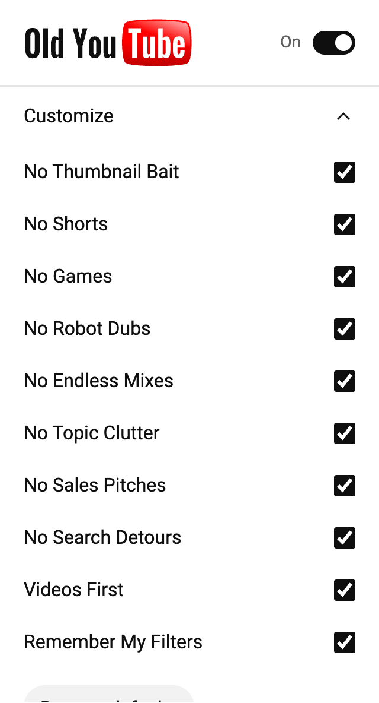
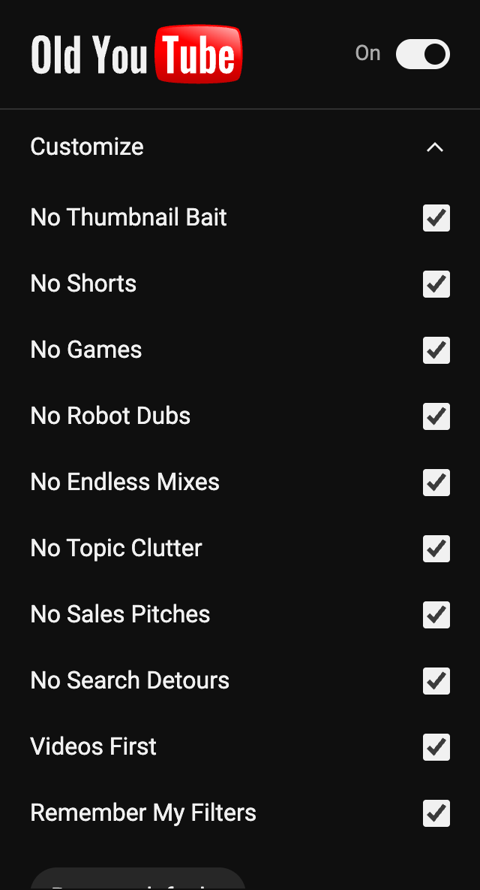

# Old YouTube

A calmer YouTube

A small extension for desktop Chrome and Brave that removes distracting extras and makes video search more focused. Turn it on and browse. Customization is there when you want it.

<p>
  
  
</p>

## What it does

Everything below is enabled by default.

| Feature | Behavior |
| --- | --- |
| No Thumbnail Bait (experimental) | Replaces ordinary video thumbnails with YouTube's second generated still. Loads near the viewport and keeps the original when unavailable. |
| Shorts | Hides Shorts cards, shelves, navigation entries and channel tabs. Direct Shorts links open in the regular video player. |
| Playables | Hides games, their shelves and navigation entries. |
| Auto-dubbed videos | Hides cards carrying YouTube's English **Auto-dubbed** badge. |
| Mixes | Hides generated and personalized mixes. Keeps regular playlists. |
| Topic chips | Removes topic suggestions from feeds and beside videos. Keeps native search filters. |
| Promotions | Hides supported Premium nudges, surveys, community-post shelves and shopping extras. |
| Search cleanup | Removes recommendation shelves and promoted modules from search results. |
| Video search | Starts new searches with YouTube's native **Videos** filter. Your explicit choices take precedence. |
| Filter memory | Remembers your last native search filter, including **All**. |

Normal videos, subscriptions, playlists, comments, history and playback remain available.

## Install

1. [Download the repository ZIP](https://github.com/emilianoabad/old-youtube/archive/refs/heads/main.zip) and extract it to a folder you will keep.
2. Open `brave://extensions` or `chrome://extensions`.
3. Enable **Developer mode**.
4. Click **Load unpacked** and select the **`extension`** folder inside the download.
5. Refresh your YouTube tabs. Pin **Old YouTube** from the browser's Extensions menu for easy access.

No build step, account or API key is needed. This version is installed manually from source; it is not a Chrome Web Store listing.

To update, replace the files in the same folder, click **Reload** on the extension's browser management page, then refresh YouTube.

## Use

Click the outline play icon in your toolbar to switch **Old YouTube** on or off. Open **Customize** to change individual options, or choose **Restore defaults** to reset them and the remembered search filter.

The popup follows your system's light or dark appearance. Visibility settings update open YouTube pages immediately. Search settings take effect on your next search or navigation; switching the extension off does not remove filters already in a search URL.

## Privacy

- Runs only on `https://www.youtube.com/*`.
- Requests only the **storage** API permission, for local preferences and a native search-filter value.
- No analytics, telemetry, remote code or extension servers.
- Does not collect searches, watch history or account data.
- All icons and lettering are bundled locally.

With **No Thumbnail Bait** enabled, generated images are requested directly from YouTube's thumbnail CDN (`i.ytimg.com`). There is no third-party thumbnail service and no video download. Availability results are cached in memory, not in browsing history or persistent storage.

YouTube still receives your normal browsing requests. The extension cleans up the page in your browser.

## Limits

Old YouTube cleans up the current desktop site; it does not restore an archived YouTube layout or change its recommendation algorithm. It cannot recover search results YouTube did not return, and it is not a general ad blocker. Thumbnail density and autoplay are unchanged.

Auto-dubbed filtering depends on the English badge being present. It hides those cards; it does not switch audio tracks or detect unlabelled dubs. A few navigation labels also depend on YouTube's language.

Generated video stills are usually lower resolution than uploaded thumbnails. The selected frame may be unrepresentative or include text already in the video; this is not a clickbait detector. This feature skips playlist artwork and recognized live/upcoming badges. The image endpoint is undocumented and may not be available for every video.

YouTube regularly changes its markup and tests different layouts, so some selectors may need updating. Mobile YouTube, embedded players and native apps are outside this version's scope. Native search-filter encoding is undocumented, and applying a filter may briefly reload the page.

## Development

Manifest V3, vanilla JavaScript and CSS. No runtime dependencies. Development uses Node.js 20+ and Playwright.

```sh
git clone https://github.com/emilianoabad/old-youtube.git
cd old-youtube
npm ci
npm run check
npm test
npm run test:browser
```

Tests use Brave automatically at its default macOS location. On other systems, set `BROWSER_PATH` to a compatible Brave/Chromium executable, or install Playwright's Chromium with `npx playwright install chromium`.

```sh
# Open an isolated Brave profile for manual testing.
npm run dev:brave

# Rebuild toolbar PNGs after editing the SVG source.
npm run icons
```

The preview launcher uses a separate profile in the operating system's temporary directory. It never changes your everyday browser profile. Set `BROWSER_PATH` when Brave is installed elsewhere.

| File | Responsibility |
| --- | --- |
| `extension/core.js` | Defaults, settings validation and URL handling |
| `extension/content.js` | Page updates, card detection and search-filter memory |
| `extension/thumbnails.js` | Lazy video-frame replacement, availability checks and restoration |
| `extension/content.css` | Reversible hiding rules and layout adjustments |
| `extension/popup.*` | On/off switch and optional settings |
| `extension/icons/toolbar.svg` | Editable toolbar icon |

The tests cover defaults, pause/resume, dynamic and recycled cards, client-side navigation, Shorts redirects, native search filters, persistence, resets, auto-dubbed cards, mixes, homepage header spacing and reversible video-frame thumbnails with missing-image fallbacks. Browser test output goes to the operating system's temporary directory.

For selector changes, also check Home, Search, Subscriptions, a channel and a watch page on the live site. Automated tests use fixtures and cannot cover every YouTube experiment.

## Report an issue

[Open an issue](https://github.com/emilianoabad/old-youtube/issues) with your browser version, YouTube language, the affected page and steps to reproduce. A screenshot can help; remove any personal information before sharing it.

## Credits

The popup wordmark is inspired by the [classic YouTube logo](https://commons.wikimedia.org/wiki/File:Logo_of_YouTube_(2006-2011).svg), with [Oswald](https://github.com/googlefonts/OswaldFont) lettering converted to vector outlines. The toolbar uses a separate outline play icon.

Independent project. Not affiliated with or endorsed by YouTube or Google. YouTube names and marks belong to their respective owners.
